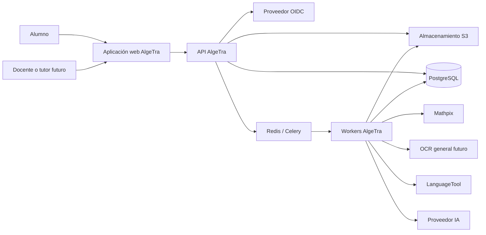
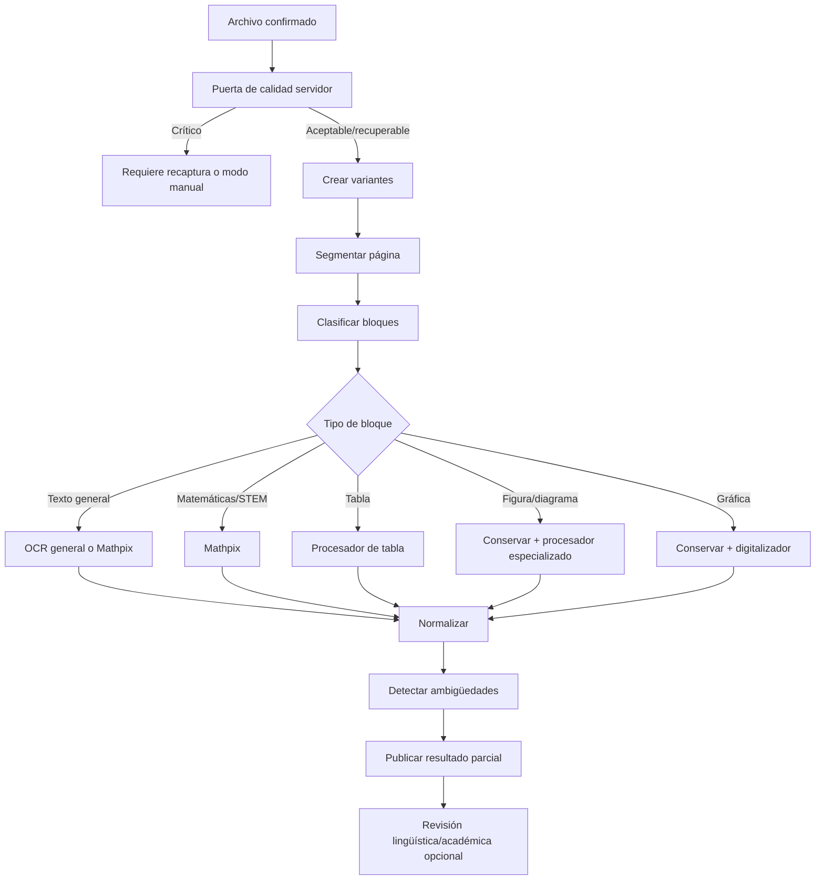
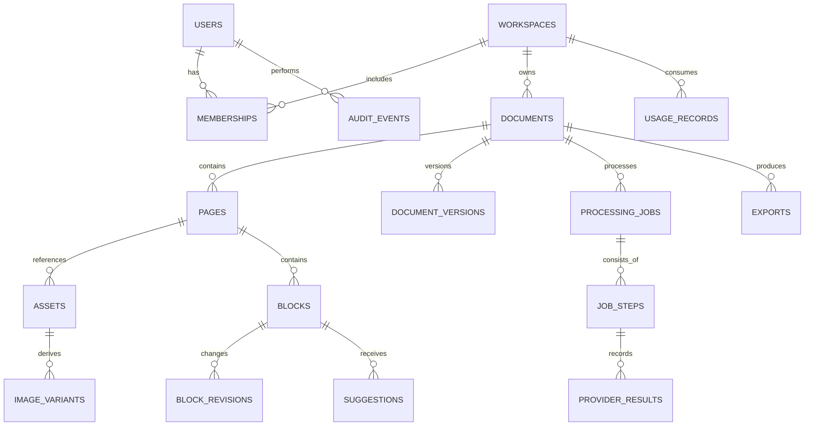

# Propuesta de arquitectura y tecnologías

> **Versión:** 0.1  
> **Estado:** arquitectura base aprobada a nivel de propuesta  
> **Fecha:** 2026-10-03  
> **Requisitos rectores:** [ERS](./03-ers-especificacion-de-requisitos.md)

## 1. Resumen de decisión

AlgeTra se implementará inicialmente como un **monolito modular con procesamiento asíncrono**:

- Aplicación web React/TypeScript creada con Vite.
- API y dominio en Python/FastAPI.
- PostgreSQL como fuente durable de datos y estado.
- S3/MinIO para imágenes, originales, resultados grandes y exportaciones.
- Celery con Redis para trabajos asíncronos iniciales.
- Workers escalables por clase de carga.
- Mathpix integrado como adaptador OCR STEM, no como modelo de dominio.
- Procesadores adicionales conectados mediante puertos estables.
- Server-Sent Events para actualizaciones de progreso.

No se crearán microservicios por materia. Español, matemáticas, química o diagramas serán módulos/procesadores detrás de contratos comunes hasta que una necesidad de escalado, seguridad o despliegue independiente justifique separarlos.

## 2. Impulsores arquitectónicos

1. **Primera respuesta rápida:** la aplicación debe reaccionar antes de que termine OCR.
2. **Procesos lentos y externos:** OCR, IA y exportación no caben en una petición web normal.
3. **Fidelidad:** original, derivados, OCR y ediciones deben permanecer separados.
4. **Documentos mixtos:** una página puede contener texto, matemáticas, tabla, gráfica y diagrama.
5. **Extensibilidad:** nuevos procesadores no deben cambiar el núcleo ni los documentos existentes.
6. **Costo:** se debe evitar procesar imágenes irrecuperables o duplicadas.
7. **Privacidad:** puede existir contenido de menores y proveedores externos.
8. **Evolución operativa:** el sistema debe escalar horizontalmente sin adoptar complejidad distribuida prematura.

## 3. Decisiones principales

| ID | Decisión | Justificación |
| --- | --- | --- |
| ARQ-001 | React + Vite para la aplicación principal | La mayor parte es un editor interactivo privado; no necesita SSR para su función principal. |
| ARQ-002 | Astro no será el runtime principal | Sus ventajas de contenido estático se reducen cuando casi toda la pantalla es una isla interactiva. Puede usarse para sitio público o documentación. |
| ARQ-003 | FastAPI/Python para backend | Ecosistema adecuado para OpenCV, scikit-image, SymPy, Pint, química, IA y procesamiento documental. |
| ARQ-004 | Monolito modular | Menor costo operativo, transacciones simples y límites internos que permiten separar después. |
| ARQ-005 | Procesamiento asíncrono con Celery/Redis | Permite comenzar con infraestructura conocida y workers horizontales. El estado de negocio seguirá en PostgreSQL. |
| ARQ-006 | PostgreSQL relacional + JSONB acotado | Relaciones y consistencia para negocio; flexibilidad para nodos versionados sin guardar un documento ilimitado en una fila. |
| ARQ-007 | Binarios en S3/MinIO | Escala de archivos, URLs firmadas, ciclo de vida y separación de base de datos. |
| ARQ-008 | Modelo documental canónico propio | Evita acoplamiento a Mathpix Markdown, Tiptap, un LLM o un formato de exportación. |
| ARQ-009 | Enrutamiento por bloque | Las páginas son multidisciplinarias y los procesadores tienen capacidades diferentes. |
| ARQ-010 | SSE para progreso | Comunicación servidor-cliente unidireccional más simple que WebSocket; polling será respaldo. |
| ARQ-011 | PDF mediante HTML/CSS y Playwright | Reutiliza diseño web, fuentes, KaTeX y reglas de impresión con control de paginación. |
| ARQ-012 | Adaptadores para servicios externos | Permite fallback, benchmarks, pruebas y sustitución de proveedor. |

## 4. Vista de contexto



## 5. Vista de contenedores

| ID | Contenedor | Responsabilidades | Tecnología inicial |
| --- | --- | --- | --- |
| ARC-WEB | Aplicación web | Captura, calidad rápida, carga, edición, progreso, revisión y vista previa | React, TypeScript, Vite |
| ARC-API | API | Autenticación, autorización, documentos, trabajos, cuotas, URLs firmadas y OpenAPI | FastAPI, Pydantic |
| ARC-DOC | Dominio documental | Modelo canónico, versiones, reglas, ambigüedades y sugerencias | Python puro dentro del monolito |
| ARC-QUALITY | Procesamiento de imagen | Calidad autoritativa, transformaciones, variantes, geometría | OpenCV, scikit-image |
| ARC-ORCH | Orquestación | Planificar pasos, idempotencia, reintentos, estados y callbacks | Celery, Redis, PostgreSQL |
| ARC-OCR | Procesadores OCR | Segmentación, clasificación, Mathpix, OCR general y normalización | Adaptadores Python |
| ARC-REVIEW | Revisión | LanguageTool, SymPy, Pint, IA y procesadores por disciplina | Servicios/modulos Python |
| ARC-COMP | Composición/exportación | Plantillas, paginación, preview y PDF | HTML/CSS, Playwright/Chromium |
| ARC-DATA | Persistencia | Metadatos, archivos, versiones, procedencia, auditoría y consumo | PostgreSQL, S3/MinIO |
| ARC-OBS | Observabilidad | Trazas, métricas, logs, alertas y costo | OpenTelemetry y backend a seleccionar |

Los identificadores `ARC-*` se utilizan en la [matriz de trazabilidad](./10-matriz-de-trazabilidad.md).

## 6. Frontend

### 6.1. Tecnologías

| Necesidad | Tecnología | Uso previsto |
| --- | --- | --- |
| UI | React + TypeScript | Componentes interactivos y tipados |
| Build | Vite | Desarrollo rápido y bundle de aplicación |
| Rutas | React Router | Navegación autenticada y recuperación por URL |
| Estado remoto | TanStack Query | Caché, invalidación, reintentos y estados de servidor |
| Estado efímero | Estado local y, solo si se justifica, Zustand | Herramientas y selección del editor |
| Editor | Tiptap/ProseMirror | Superficie de edición y nodos personalizados |
| Matemáticas | MathLive + KaTeX | Entrada LaTeX y render rápido |
| Formularios | React Hook Form + Zod | Formularios y validación cliente |
| Diagramas | React Flow | Nodos y conexiones en RF-047 |
| Gráficas | Plotly.js | Series y ejes en RF-048 |
| UI visual | Tailwind CSS + shadcn/ui | Sistema de diseño y componentes accesibles |
| Pruebas | Vitest, Testing Library y Playwright | Unitarias, componentes y end-to-end |

### 6.2. Módulos de interfaz

```text
web/
  app-shell
  identity
  documents
  capture
  upload
  quality
  processing-status
  editor
  review
  diagrams
  charts
  composition
  exports
  settings
  shared
```

Esta es una orientación de límites, no una instrucción de crear aún cada módulo.

### 6.3. Responsabilidad del cliente

El cliente puede:

- Crear miniaturas con URLs locales.
- Medir señales rápidas de desenfoque, exposición, encuadre y perspectiva.
- Comprimir o redimensionar una copia de transporte según política.
- Calcular un hash cuando el costo en el dispositivo sea razonable.
- Subir directamente mediante URL firmada.
- Mantener una cola local de páginas antes de confirmar.
- Suscribirse a eventos y mostrar resultados parciales.
- Mantener ediciones locales mientras espera confirmación.

El cliente no decide de forma definitiva:

- Autorización.
- Facturación o cuotas.
- Estado durable.
- Resultado de calidad autoritativo.
- Aceptación de callbacks externos.
- Qué datos pertenecen a otro usuario.

### 6.4. Trabajo fuera del hilo principal

Redimensionamiento, hash y análisis de imagen suficientemente costosos se ejecutarán en Web Workers. Se limitará el número de páginas procesadas simultáneamente según memoria y capacidad del dispositivo.

### 6.5. Tiptap no es el modelo de dominio

El JSON de ProseMirror será una proyección editable. Un adaptador convertirá entre nodos de UI y nodos canónicos. De esta forma se podrá sustituir el editor o generar otros formatos sin migrar toda la lógica de negocio.

## 7. Backend modular

### 7.1. Módulos propuestos

```text
backend/
  identity/
  workspaces/
  documents/
  assets/
  quality/
  processing/
  ocr/
  document_model/
  reviews/
  composition/
  exports/
  usage/
  audit/
  notifications/
  shared/
```

Cada módulo deberá exponer casos de uso y contratos. No accederá directamente a tablas internas de otro módulo salvo una decisión explícita. Al inicio podrán compartir proceso, despliegue y transacción.

### 7.2. Capas

- **API:** transporte HTTP, autenticación, validación y serialización.
- **Aplicación:** casos de uso y transacciones.
- **Dominio:** entidades, reglas y estados sin dependencia de FastAPI o SQLAlchemy.
- **Infraestructura:** repositorios, proveedores, colas, archivos y telemetría.

### 7.3. Contratos

- OpenAPI será generado desde esquemas Pydantic.
- El cliente TypeScript se generará o validará contra OpenAPI.
- Errores externos se traducirán a una taxonomía interna.
- Eventos internos y documentos canónicos tendrán una versión explícita.

## 8. Pipeline de procesamiento



### 8.1. Idempotencia

Una clave de procesamiento debe incorporar, según el paso:

- Hash del activo o región.
- Identificador y versión de transformación.
- Procesador, modelo y opciones relevantes.
- Versión de esquema de salida.
- Ámbito de usuario/organización cuando la reutilización no sea globalmente segura.

La deduplicación nunca reutilizará un activo privado entre usuarios sin una política explícita. Puede evitar una segunda llamada del mismo usuario o detectar el duplicado sin revelar su existencia a terceros.

### 8.2. Colas

Colas iniciales recomendadas:

- `image-quality`
- `image-enhancement`
- `ocr-interactive`
- `ocr-batch`
- `review-language`
- `review-domain`
- `review-ai`
- `export`
- `maintenance`

Cada cola podrá tener concurrencia, timeout, reintentos y límites propios. Los trabajos interactivos no competirán sin control con cargas masivas.

### 8.3. Estado durable

Celery transporta ejecución; PostgreSQL registra intención y estado. El patrón será:

1. Transacción crea o actualiza el trabajo.
2. Un outbox registra el evento a publicar.
3. Un publicador envía a la cola.
4. El worker reclama un paso mediante operación idempotente.
5. Persiste resultado y evento antes de confirmar el mensaje.

Esto reduce trabajos “fantasma” creados en base pero nunca encolados, o encolados sin estado de negocio.

## 9. Calidad y mejora de imagen

### 9.1. Dos niveles de evaluación

1. **Cliente:** respuesta rápida para recapturar antes de cargar.
2. **Servidor:** evaluación reproducible y autoritativa antes de un servicio facturable.

### 9.2. Señales

- Nitidez/desenfoque.
- Movimiento.
- Histograma, sombras y exposición extrema.
- Contraste local de trazos.
- Página incompleta o fuera del marco.
- Perspectiva y rotación.
- Resolución efectiva.
- Reflejo o regiones saturadas.

### 9.3. Variantes no destructivas

Según las señales se podrán generar:

- Corrección de perspectiva y orientación.
- Normalización de iluminación/fondo.
- Canal de color de mayor separación.
- Escala de grises.
- CLAHE.
- Reducción moderada de ruido.
- Enfoque moderado.
- Umbral adaptativo, Otsu, Sauvola o Niblack.
- Morfología ligera para trazos delgados.

No se aplicará una cadena fija. Cada transformación registrará parámetros. Se conservará una variante de color o gris sin binarización para evitar eliminar lápiz tenue, puntos o signos.

### 9.4. Selección

La selección podrá combinar:

- Métricas visuales.
- Contenido recuperado.
- Confianza del OCR como una señal, no verdad.
- Consistencia lingüística o sintáctica.
- Costo y latencia.

El sistema limitará el número de variantes enviadas a proveedores. No se multiplicará el costo sin una política y beneficio medido.

### 9.5. Mejora generativa

No formará parte de la ruta de verdad P0. Una técnica generativa puede inventar trazos. Si se investiga posteriormente, su salida deberá identificarse, compararse y quedar excluida de la transcripción automática predeterminada.

## 10. Modelo documental canónico

### 10.1. Principios

- Independiente de proveedor y editor.
- Nodos con identificadores estables.
- Geometría normalizada y transformación conocida.
- Procedencia por campo o bloque relevante.
- Contenido y estilo separados.
- Extensible mediante tipos versionados.
- Capaz de conservar un bloque visual aunque no pueda interpretarlo.

### 10.2. Tipos iniciales

```text
document
page
heading
paragraph
list
table
equation
procedure
chemical_structure
diagram
flowchart
chart
figure
form_field
annotation
unknown
```

### 10.3. Ejemplo conceptual

```json
{
  "schemaVersion": "1.0",
  "id": "block_...",
  "type": "equation",
  "pageId": "page_...",
  "geometry": {
    "space": "normalized-page",
    "polygon": [[0.12, 0.31], [0.74, 0.31], [0.74, 0.40], [0.12, 0.40]]
  },
  "source": {
    "assetId": "asset_...",
    "variantId": "variant_...",
    "cropId": "asset_crop_..."
  },
  "transcription": {
    "format": "latex",
    "value": "x^2 + 2x + 1",
    "provider": "mathpix",
    "providerVersion": "opaque-value",
    "confidence": 0.91
  },
  "currentContent": {
    "format": "latex",
    "value": "x^2 + 2x + 1"
  },
  "review": {
    "status": "pending",
    "ambiguities": []
  },
  "revision": 3
}
```

La confianza se conserva, pero no convierte el bloque en correcto. El resultado bruto completo se guarda fuera o en una entidad de proveedor relacionada.

### 10.4. Versiones

- Las ediciones crean revisiones o parches agrupados.
- Se generarán snapshots periódicos para evitar reproducir una cadena ilimitada.
- Restaurar crea una versión nueva; no elimina historia.
- Las sugerencias apuntan a una revisión objetivo y se vuelven obsoletas si cambia el rango de manera incompatible.

## 11. Procesadores multidisciplinarios

### 11.1. Contrato conceptual

Un procesador declara:

- Tipos de bloque aceptados.
- Idiomas o dominios.
- Requisitos de entrada.
- Si usa proveedor externo.
- Unidad de costo.
- Timeout y política de reintento.
- Versión y esquema de salida.
- Capacidades: extraer, validar, sugerir o renderizar.

Salida común:

- Resultado estructurado.
- Confianza o advertencias.
- Procedencia.
- Alternativas.
- Errores normalizados.
- Métricas de consumo.

### 11.2. Procesadores iniciales

| Procesador | Función | Horizonte |
| --- | --- | --- |
| Mathpix | Texto STEM, matemáticas, tablas, estructura y regiones | P0 |
| LanguageTool | Ortografía, gramática y puntuación en español | P0 |
| SymPy | Equivalencia y operaciones matemáticas representables | P0 |
| Pint | Dimensiones y unidades | P1 |
| OCR general | Escritura y texto general en español | P1 tras benchmark |
| IA textual/multimodal | Clasificación, explicación y sugerencias estructuradas | P0 limitado/P1 |
| DECIMER/RDKit | Reconocimiento y validación química | P2 |
| Diagrama | Formas, nodos, etiquetas y conexiones | P1 |
| Gráfica | Ejes, calibración y series | P1 |

### 11.3. Orden de revisión

1. Calidad de captura.
2. Transcripción.
3. Validación de ambigüedad OCR.
4. Validadores deterministas.
5. Revisión lingüística.
6. Revisión académica con IA y fuentes.
7. Decisión del usuario.

La IA no debe intentar corregir académicamente una expresión que todavía puede ser un error de OCR sin indicar esa condición.

## 12. Persistencia

### 12.1. Entidades principales



### 12.2. Responsabilidad de PostgreSQL

- Identidad referenciada y membresías.
- Metadatos de documentos y páginas.
- Estado de trabajos y outbox.
- Bloques actuales y revisiones manejables.
- Sugerencias y decisiones.
- Exportaciones y referencias a objetos.
- Cuotas, uso, costo estimado y auditoría.

### 12.3. Responsabilidad de almacenamiento de objetos

- Originales.
- Variantes procesadas.
- Recortes cuando convenga materializarlos.
- Respuestas brutas grandes.
- Previews y exportaciones.
- Fixtures privados autorizados para evaluación, con política separada.

### 12.4. JSONB

Se usará para contenido flexible acotado, no como sustituto indiscriminado del modelo relacional. Un bloque o snapshot de página puede ser una unidad razonable. Campos consultados con frecuencia —propietario, estado, tipo, página, timestamps, proveedor— permanecerán normalizados e indexables.

## 13. API y eventos

### 13.1. Recursos orientativos

```text
/v1/documents
/v1/documents/{documentId}
/v1/documents/{documentId}/pages
/v1/pages/{pageId}/quality
/v1/pages/{pageId}/process
/v1/blocks/{blockId}
/v1/blocks/{blockId}/suggestions
/v1/documents/{documentId}/versions
/v1/documents/{documentId}/preview
/v1/documents/{documentId}/exports
/v1/jobs/{jobId}
/v1/jobs/{jobId}/events
```

Los endpoints definitivos se diseñarán por casos de uso y no replicarán tablas.

### 13.2. Concurrencia

Las mutaciones usarán número de revisión, `ETag/If-Match` o un mecanismo equivalente. Un cliente no sobrescribirá silenciosamente una versión más nueva.

### 13.3. Eventos SSE

Cada evento incluirá:

- `event_id` monotónico o reanudable.
- `job_id` y alcance.
- fase y estado reales.
- página/bloque cuando aplique.
- progreso basado en unidades reales o `indeterminate`.
- enlace o identificador del resultado parcial.
- error normalizado y acciones posibles.

El cliente enviará `Last-Event-ID` al reconectar. Si el historial expiró, consultará el snapshot durable.

## 14. Composición y exportación

### 14.1. Proyección

El modelo canónico se proyectará a una representación de composición con:

- Plantilla.
- Variables de portada.
- Tokens de estilo.
- Reglas de página.
- Nodos renderizables.
- Recursos locales autorizados.

### 14.2. PDF

Un worker aislado generará HTML y abrirá Chromium mediante Playwright. Reglas:

- Recursos externos bloqueados por defecto o permitidos mediante lista.
- Fuentes y KaTeX empaquetados o servidos desde origen controlado.
- Timeout y límite de memoria.
- Contenido sanitizado.
- Artefacto asociado a una versión inmutable.
- Caché por versión + plantilla + opciones.

## 15. Rendimiento por diseño

- Vista previa y validación rápida antes de red.
- URLs firmadas para evitar que API transporte binarios.
- Carga multipart o reanudable cuando tamaño lo justifique.
- Resultados por página/bloque.
- Índices de consultas de listado y estado.
- Pool de conexiones controlado.
- Caché únicamente para datos reconstruibles.
- Colas separadas para impedir bloqueo de trabajos interactivos.
- Límites de concurrencia por proveedor y usuario.
- Cancelación cooperativa entre pasos.
- Render virtualizado del editor.
- Prefetch de recortes siguiente/anterior en revisión.

Los detalles de comunicación se encuentran en [Rendimiento y experiencia percibida](./09-rendimiento-y-experiencia.md).

## 16. Seguridad y privacidad

### 16.1. Identidad

Se elegirá un proveedor OIDC en `DA-001`. La API validará tokens o sesiones y derivará un principal. No confiará en identificadores de usuario enviados libremente por el cliente.

### 16.2. Autorización

- Ámbito obligatorio de workspace/documento.
- Comprobación en API y generación de URL firmada.
- Eventos SSE filtrados por principal.
- Objetos con claves no predecibles, sin sustituir autorización.
- RLS de PostgreSQL podrá añadirse como defensa adicional, no como única capa, si la estrategia de conexión lo permite.

### 16.3. Proveedores

- Credenciales solo en workers o backend.
- Envío del mínimo contenido necesario.
- Configuración de retención/privacidad cuando exista.
- Registro de qué proveedor recibió qué activo lógico.
- Circuit breaker y límites de tasa.
- Webhooks con firma, timestamp, protección de replay e idempotencia.

### 16.4. Menores

Antes de producción se definirán jurisdicción, edad, consentimiento, rol de tutor/institución, retención y términos. La arquitectura no asumirá que una casilla genérica resuelve estas obligaciones.

## 17. Observabilidad

- OpenTelemetry para trazas y métricas.
- Correlación desde navegador/API hasta worker/proveedor.
- Logs estructurados y redactados.
- Paneles por fase, cola, proveedor y tipo de bloque.
- Métricas de negocio agregadas: recaptura, ambigüedad, corrección y exportación.
- Costos estimados por unidad facturable.
- Alertas por error, latencia, cola, cuota y presupuesto.

No se utilizará el texto del alumno como etiqueta de log ni atributo de métrica.

## 18. Despliegue

### 18.1. Desarrollo local

Docker Compose podrá ejecutar:

- PostgreSQL.
- Redis.
- MinIO.
- API.
- Uno o más workers.
- LanguageTool autoalojado.
- Aplicación web en modo desarrollo.

Los proveedores externos se sustituirán por fakes en pruebas normales y se habilitarán explícitamente para pruebas de integración.

### 18.2. Producción inicial

- Frontend en CDN/hosting estático.
- API y workers en plataforma de contenedores gestionada.
- PostgreSQL gestionado con backup.
- Redis gestionado o desplegado con persistencia adecuada al broker, sin tratarlo como base de negocio.
- Almacenamiento de objetos gestionado.
- Gestor de secretos.
- Red y políticas de egreso controladas.

### 18.3. Mediano plazo

- Autoescalado por profundidad de cola y latencia.
- Pools separados para CPU/GPU/exportación.
- Temporal Cloud o autoalojado si se aprueba la migración.
- Mathpix Files API para importaciones masivas no interactivas.
- Despliegues regionales si privacidad y demanda lo requieren.

## 19. Estrategia de pruebas

| Nivel | Alcance |
| --- | --- |
| Unitarias | Dominio, estados, reglas, transformaciones y permisos |
| Propiedad | Geometría, conversiones, idempotencia y modelo canónico cuando sea útil |
| Integración | PostgreSQL, S3, Redis, LanguageTool y exportación |
| Contrato | Mathpix, OCR general, IA, webhooks y OpenAPI |
| Golden dataset | Calidad de imagen, OCR, matemática y estructuras |
| E2E | Captura, recaptura, proceso parcial, revisión, edición y PDF |
| Carga | API, carga directa, colas, SSE y exportación concurrente |
| Resiliencia | Caída, timeout, cuota, callback duplicado, reinicio y desconexión |
| Seguridad | Autorización, carga hostil, sanitización, secretos y aislamiento |
| Accesibilidad | Teclado, foco, lector, contraste, zoom y movimiento reducido |

## 20. Criterios para separar un servicio

Un módulo solo debería separarse si al menos una condición está demostrada:

- Necesita escalar con un perfil muy distinto y el worker separado no es suficiente.
- Requiere GPU o dependencias incompatibles.
- Tiene un límite fuerte de seguridad o residencia.
- Necesita despliegue y ciclo de vida independiente.
- Su indisponibilidad debe aislarse más allá de una cola/proceso.
- Un equipo independiente necesita propiedad y contrato estable.

La separación requerirá plan de datos, observabilidad, idempotencia, fallos distribuidos y costo operativo.

## 21. Decisiones aún abiertas

- Proveedor OIDC.
- Plataforma de despliegue.
- Segundo OCR.
- Proveedor de IA.
- Backend de OpenTelemetry/logs/alertas.
- Herramienta genérica de diagramas además de React Flow.
- Biblioteca/editor químico.
- Estrategia exacta de carga reanudable.
- Umbrales de calidad después del benchmark.

## 22. Referencias técnicas consultadas

| Tema | Fuente | Consecuencia arquitectónica |
| --- | --- | --- |
| Capacidades de Mathpix | [Mathpix OCR API](https://docs.mathpix.com/) | Mathpix reconoce texto y contenido STEM, pero se mantiene detrás de un adaptador. |
| Imágenes, geometría y diagramas | [Mathpix: Process an Image](https://docs.mathpix.com/guides/image-ocr) | Se aprovechan contornos/confianza; un diagrama genérico puede detectarse sin convertirse, por lo que se exige fallback visual. |
| Tipos, confianza y química | [Mathpix: POST v3/text](https://docs.mathpix.com/reference/post-v3-text) | La confianza no es garantía y SMILES es experimental; se requiere validación. |
| Cargas masivas | [Mathpix Files API](https://docs.mathpix.com/guides/files-api-overview) | Se reserva para mediano plazo y procesos no interactivos. |
| Escritura general | [Google Cloud Vision: handwriting](https://cloud.google.com/vision/docs/handwriting) | Candidato de benchmark para un adaptador general, no decisión automática. |
| Español manuscrito | [Azure Document Intelligence: idiomas OCR](https://learn.microsoft.com/en-us/azure/ai-services/document-intelligence/language-support/ocr?view=doc-intel-4.0.0) | Azure es candidato explícito para el benchmark de español manuscrito. |
| Umbral adaptativo | [OpenCV: image thresholding](https://docs.opencv.org/4.x/d7/d4d/tutorial_py_thresholding.html) | Se generan variantes según iluminación, sin una binarización universal. |
| Contraste local | [OpenCV: CLAHE](https://docs.opencv.org/4.x/d5/daf/tutorial_py_histogram_equalization.html) | CLAHE es una opción para trazos tenues con control para no amplificar ruido. |
| Preparación para OCR | [Tesseract: Improving Quality](https://tesseract-ocr.github.io/tessdoc/ImproveQuality.html) | Se contemplan escala, binarización, ruido, morfología y corrección de inclinación. |
| Revisión lingüística | [LanguageTool para desarrollo](https://languagetool.org/dev) | LanguageTool puede autoalojarse y se usa como corrector determinista inicial. |
| Química dibujada | [DECIMER Image Transformer](https://github.com/Kohulan/DECIMER-Image_Transformer) | Candidato P2 para imágenes químicas, sujeto a benchmark y operación de modelos. |
| Digitalización de gráficas | [WebPlotDigitizer](https://automeris.io/docs/) | Confirma el enfoque combinado de visión y calibración manual. |
| Ejecución durable futura | [Temporal](https://docs.temporal.io/temporal) | Alternativa de mediano plazo para workflows complejos y recuperables. |
| Cola inicial | [Celery](https://docs.celeryq.dev/en/stable/getting-started/introduction.html) | Sustenta workers horizontales, reintentos y colas; exige idempotencia propia. |
| Documentos flexibles | [PostgreSQL JSONB](https://www.postgresql.org/docs/current/datatype-json.html) | JSONB se usa en unidades acotadas y no como una fila monolítica para todo el documento. |

## 23. Decisión arquitectónica formal

La elección de un **monolito modular escalable con procesamiento asíncrono** y los criterios para extraer módulos como servicios independientes quedan formalizados en [ADR-001](./artefactos/07-adr-001-arquitectura-monolito-modular.md). El [FBS](./artefactos/05-feature-breakdown-structure.md) y el [feature model](./artefactos/06-feature-model.md) descomponen las capacidades sin convertirlas automáticamente en microservicios.
