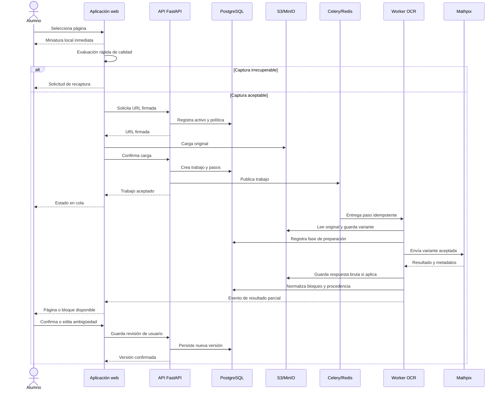
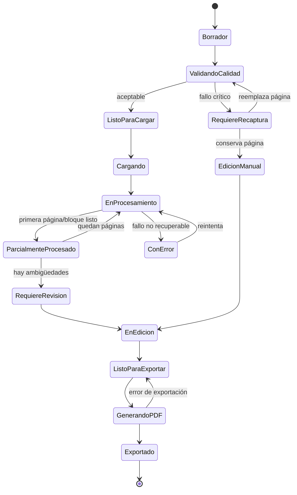

# ART-005 — Flujo de usuario y sistema

> **Tipo:** diagrama de proceso  
> **Versión:** 1.0  
> **Estado:** propuesta para prototipos A y B  
> **Fecha:** 2026-11-05

## 1. Objetivo

Este artefacto representa el flujo que conecta las acciones del alumno con las respuestas del sistema. Incluye la puerta de calidad, el procesamiento asíncrono, los resultados parciales, la revisión y la exportación.

## 2. Diagrama principal

```mermaid
flowchart TD
    U0([Alumno inicia]) --> U1[Selecciona o captura páginas]
    U1 --> S1[Cliente crea miniaturas locales]
    S1 --> S2[Cliente valida formato y señales rápidas]
    S2 --> Q{¿La captura es recuperable?}

    Q -- "No" --> S3[Explica defecto y recomienda recaptura]
    S3 --> U2{¿Recapturar o modo manual?}
    U2 -- Recapturar --> U1
    U2 -- "Modo manual" --> M1[Crear página manual sin afirmar OCR]
    M1 --> E1[Editor]

    Q -- "Sí" --> U3[Confirma páginas y orden]
    U3 --> A1[API registra documento y genera URL firmada]
    A1 --> U4[Cliente carga originales al almacenamiento]
    U4 --> A2[API crea trabajo durable]
    A2 --> W1[Worker prepara variantes no destructivas]
    W1 --> W2[Worker segmenta y clasifica bloques]
    W2 --> W3{¿Tipo de bloque?}

    W3 -- Texto/Math --> P1[Mathpix u OCR compatible]
    W3 -- Tabla --> P2[Procesador de tabla]
    W3 -- Figura/diagrama/gráfica --> P3[Conservar región y procesar si aplica]
    P1 --> N1[Normalizador canónico]
    P2 --> N1
    P3 --> N1
    N1 --> C1{¿Resultado ambiguo?}
    C1 -- Sí --> R1[Marcar bloque y guardar recorte]
    C1 -- No --> R2[Publicar bloque real]
    R1 --> R2
    R2 --> E1[Editor y revisión progresiva]

    E1 --> U5[Alumno compara imagen y transcripción]
    U5 --> U6{¿Confirmar o editar?}
    U6 -- Editar --> V1[Crear revisión de usuario]
    U6 -- Confirmar --> V2[Marcar bloque validado]
    V1 --> E1
    V2 --> R3{¿Solicitar revisión adicional?}

    R3 -- Sí --> P4[LanguageTool, validadores o IA habilitada]
    P4 --> S4[Mostrar sugerencias separadas]
    S4 --> U7[Alumno acepta, rechaza o edita]
    U7 --> V1
    R3 -- No --> C2[Composición del entregable]
    V1 --> C2

    C2 --> U8[Alumno aplica portada y formato]
    U8 --> X{¿Hay asuntos bloqueantes?}
    X -- Sí --> U5
    X -- No --> U9[Solicita vista previa y PDF]
    U9 --> W4[Worker renderiza HTML/CSS con Playwright]
    W4 --> X2{¿Exportación correcta?}
    X2 -- No --> S5[Conservar documento y mostrar reintento]
    S5 --> U9
    X2 -- Sí --> F1([PDF trazable disponible])
```



## 3. Secuencia asíncrona



## 4. Estados visibles del trabajo



## 5. Reglas del flujo

1. La miniatura local no significa que la página ya fue cargada.
2. La aceptación del trabajo no significa que el OCR terminó.
3. Un resultado parcial debe ser contenido real y tener alcance identificado.
4. Una captura irrecuperable se detiene antes de OCR o IA facturable.
5. Una página fallida no debe ocultar las páginas sanas.
6. La revisión académica debe indicar sobre qué versión de la transcripción trabaja.
7. Un placeholder no participa en el modelo canónico ni en la exportación.
8. El PDF debe estar asociado a una versión y plantilla concretas.

## 6. Flujo mínimo del prototipo B

Para la primera rebanada vertical se implementará este subconjunto:

```text
seleccionar imagen
  → miniatura local
  → calidad básica
  → cargar original
  → crear trabajo
  → OCR Mathpix
  → normalizar párrafo/encabezado/ecuación/figura/desconocido
  → revisar una ambigüedad
  → editar texto o LaTeX
  → vista previa
  → PDF
```

La clasificación avanzada, revisión lingüística, validación académica, diagramas editables y gráficas reconstruidas se incorporarán después de medir la prueba técnica.
