# ART-007 — Feature Model de AlgeTra

> **Tipo:** modelo de variabilidad de producto<br>
> **Versión:** 1.0<br>
> **Estado:** propuesta para delimitar configuraciones de prototipo, P0, P1 y P2<br>
> **Fecha:** 2026-11-05<br>
> **Relacionado:** [FBS](./05-feature-breakdown-structure.md) y [ERS](../03-ers-especificacion-de-requisitos.md)

## 1. Propósito

El feature model representa qué capacidades son obligatorias, opcionales o mutuamente excluyentes dentro de la familia de productos AlgeTra. Permite configurar un prototipo sin confundir:

- una capacidad disponible en la arquitectura;
- una capacidad habilitada para un horizonte concreto;
- una integración externa seleccionada;
- una futura especialización todavía no validada.

El modelo describe **variabilidad de producto**, no módulos de código ni servicios de despliegue. Una feature opcional puede vivir dentro del monolito modular, en un worker especializado o detrás de un adaptador.

## 2. Notación

| Notación | Significado |
| --- | --- |
| `M` | Mandatory: debe estar en toda configuración de producto aplicable. |
| `O` | Optional: puede incluirse o excluirse. |
| `XOR` | Se selecciona exactamente una alternativa. |
| `OR` | Se selecciona una o más alternativas. |
| `[1..*]` | Grupo con al menos una selección. |
| `[0..*]` | Grupo con cero o más selecciones. |
| `→` | Implicación: si se elige la feature izquierda, la derecha también debe estar seleccionada. |
| `↔` | Equivalencia: ambas features deben compartir selección. |

`M` significa obligatorio para el producto configurado. El Prototipo A puede usar una configuración interna reducida explícitamente definida en la sección 8; no se deben interpretar sus exclusiones como ausencia del contrato futuro.

## 3. Árbol de features

```text
FM-00 AlgeTra
├── FM-01 Núcleo de captura y transformación (M)
│   ├── FM-01.01 Captura y carga (M)
│   ├── FM-01.02 Puerta de calidad (M)
│   ├── FM-01.03 Procesamiento asíncrono durable (M)
│   ├── FM-01.04 Modelo canónico y procedencia (M)
│   ├── FM-01.05 Revisión humana y edición (M)
│   ├── FM-01.06 Composición (M)
│   └── FM-01.07 Progreso y recuperación (M)
├── FM-02 Confianza y operación (M)
│   ├── FM-02.01 Autenticación y autorización (M en P0)
│   ├── FM-02.02 Privacidad, retención y eliminación (M)
│   ├── FM-02.03 Auditoría y procedencia (M)
│   ├── FM-02.04 Cuotas y costo (M)
│   ├── FM-02.05 Accesibilidad y estados honestos (M)
│   └── FM-02.06 Observabilidad (M)
├── FM-03 Contenido soportado [1..*]
│   ├── FM-03.01 Texto en español (M en P0)
│   ├── FM-03.02 Matemáticas y STEM (M en P0)
│   ├── FM-03.03 Tablas y formularios (O)
│   ├── FM-03.04 Figura visual conservada (M)
│   ├── FM-03.05 Diagramas semánticos (O)
│   ├── FM-03.06 Gráficas editables (O)
│   ├── FM-03.07 Química (O)
│   └── FM-03.08 Ciencias, física y unidades (O)
├── FM-04 Reconocimiento [1..*]
│   ├── FM-04.01 Mathpix STEM (selección actual P0)
│   ├── FM-04.02 OCR general (O)
│   ├── FM-04.03 Segundo OCR intercambiable (O)
│   └── FM-04.04 Procesador especializado por dominio (O)
├── FM-05 Revisión y validación [1..*]
│   ├── FM-05.01 Ambigüedad y comparación visual (M)
│   ├── FM-05.02 LanguageTool (selección P0)
│   ├── FM-05.03 Validación matemática con SymPy (selección P0)
│   ├── FM-05.04 Validación de unidades con Pint (O)
│   ├── FM-05.05 Revisión académica contextual (O)
│   └── FM-05.06 Sugerencias de IA (O)
├── FM-06 Entrega [1..*]
│   ├── FM-06.01 Vista previa paginada (M)
│   ├── FM-06.02 PDF (M)
│   ├── FM-06.03 DOCX u ofimática (O)
│   ├── FM-06.04 Presentación u otros formatos (O)
│   └── FM-06.05 Plantillas reutilizables (O)
└── FM-07 Escenarios de uso
    ├── FM-07.01 Benchmark técnico interno (O)
    ├── FM-07.02 Rebanada vertical evaluable (O)
    ├── FM-07.03 Producto privado P0 (M para la primera versión)
    ├── FM-07.04 Organizaciones educativas (O)
    └── FM-07.05 Colaboración autorizada (O)
```

## 4. Modelo visual

El siguiente diagrama es una vista de lectura. La tabla de features y las restricciones de la sección 6 son la definición verificable del modelo.

```mermaid
flowchart TD
    ROOT[FM-00 AlgeTra] --> CORE[FM-01 Núcleo obligatorio]
    ROOT --> TRUST[FM-02 Confianza y operación obligatoria]
    ROOT --> CONTENT[FM-03 Contenido 1..*]
    ROOT --> OCR[FM-04 Reconocimiento 1..*]
    ROOT --> REVIEW[FM-05 Revisión 1..*]
    ROOT --> DELIVERY[FM-06 Entrega 1..*]
    ROOT --> PROFILE[FM-07 Escenarios de uso]

    CORE --> CAP[Captura y carga M]
    CORE --> QUALITY[Puerta de calidad M]
    CORE --> JOBS[Trabajo asíncrono durable M]
    CORE --> MODEL[Modelo canónico M]
    CORE --> HUMAN[Revisión humana M]
    CORE --> COMPOSE[Composición M]
    CORE --> PROGRESS[Progreso y recuperación M]

    CONTENT --> TEXT[Texto español M en P0]
    CONTENT --> MATH[Math/STEM M en P0]
    CONTENT --> TABLE[Tablas O]
    CONTENT --> FIGURE[Figura visual M]
    CONTENT --> DIAGRAM[Diagramas semánticos O]
    CONTENT --> CHART[Gráficas O]
    CONTENT --> CHEM[Química O]
    CONTENT --> SCIENCE[Ciencias y unidades O]

    OCR --> MP[Mathpix actual]
    OCR --> GENERAL[OCR general O]
    OCR --> ALT[Segundo OCR O]
    OCR --> SPECIAL[Especializado O]

    REVIEW --> AMBIG[Ambigüedad y comparación M]
    REVIEW --> LANG[LanguageTool P0]
    REVIEW --> SYMPY[SymPy P0]
    REVIEW --> PINT[Pint O]
    REVIEW --> ACADEMIC[Académica contextual O]
    REVIEW --> AI[IA O]

    DELIVERY --> PREVIEW[Vista previa M]
    DELIVERY --> PDF[PDF M]
    DELIVERY --> DOCX[Ofimática O]
    DELIVERY --> OTHER[Otros formatos O]
    DELIVERY --> TEMPLATES[Plantillas O]

    AI -. requiere .-> HUMAN
    AI -. requiere .-> AUDIT[Procedencia y auditoría]
    DIAGRAM -. requiere .-> FIGURE
    CHART -. requiere .-> FIGURE
    PDF -. requiere .-> MODEL
    PDF -. requiere .-> PREVIEW
```



## 5. Catálogo y cardinalidad

### 5.1. Núcleo y confianza

| ID | Feature | Cardinalidad | Horizonte base | Motivo |
| --- | --- | --- | --- | --- |
| FM-01 | Núcleo de captura y transformación | M | Todos | Sin esta cadena no existe el producto. |
| FM-01.01 | Captura y carga | M | Todos | Recibe la evidencia del manuscrito. |
| FM-01.02 | Puerta de calidad | M | Todos | Protege calidad, costo y experiencia. |
| FM-01.03 | Procesamiento asíncrono durable | M | Todos salvo demo local mínima | OCR y exportación no deben depender de una petición abierta. |
| FM-01.04 | Modelo canónico y procedencia | M | Todos | Evita acoplar dominio, editor y proveedor. |
| FM-01.05 | Revisión humana y edición | M | Prototipo B/P0 | El usuario conserva control sobre incertidumbre y cambios. |
| FM-01.06 | Composición | M | Prototipo B/P0 | El producto entrega un documento, no solo OCR. |
| FM-01.07 | Progreso y recuperación | M | Prototipo B/P0 | La espera y reconexión deben ser comprensibles. |
| FM-02 | Confianza y operación | M | Todo acceso a datos reales | Escala sin seguridad y observabilidad no es una configuración válida. |
| FM-02.01 | Autenticación y autorización | M en P0, O en benchmark interno | P0 | El benchmark local puede trabajar con fixtures controlados. |
| FM-02.02 | Privacidad, retención y eliminación | M | Todos con datos reales | Puede haber contenido académico y menores. |
| FM-02.03 | Auditoría y procedencia | M | Todos | Cada resultado y decisión debe poder explicarse. |
| FM-02.04 | Cuotas y costo | M | Todos los proveedores externos | Impide consumos no acotados y duplicados. |
| FM-02.05 | Accesibilidad y estados honestos | M | Prototipo B/P0 | Evita presentar estimaciones o placeholders como resultado. |
| FM-02.06 | Observabilidad | M | Todos | Sin métricas no se puede validar calidad ni escala. |

### 5.2. Contenido y reconocimiento

| ID | Feature | Cardinalidad | Horizonte | Nota de configuración |
| --- | --- | --- | --- | --- |
| FM-03 | Contenido soportado | `[1..*]` | Todos | Una configuración debe seleccionar al menos un tipo. |
| FM-03.01 | Texto español | M en P0 | P0 | Camino principal de producto. |
| FM-03.02 | Matemáticas y STEM | M en P0 | P0 | Diferenciador y caso de uso central. |
| FM-03.03 | Tablas y formularios | O | P0/P1 | Si no se reconstruyen, se conserva la región. |
| FM-03.04 | Figura visual conservada | M | P0 | Fallback obligatorio para contenido no soportado. |
| FM-03.05 | Diagramas semánticos | O | P1 | Requiere comparación y revisión asistida. |
| FM-03.06 | Gráficas editables | O | P1 | Requiere calibración y validación de puntos. |
| FM-03.07 | Química | O | P2 | Depende de procesador y política especializada. |
| FM-03.08 | Ciencias, física y unidades | O | P1/P2 | Puede activar Pint, contexto y procesadores de dominio. |
| FM-04 | Reconocimiento | `[1..*]` | Todos | Los proveedores se seleccionan mediante adaptadores. |
| FM-04.01 | Mathpix STEM | O en familia, seleccionado en P0 | P0 | Proveedor inicial; no define el modelo canónico. |
| FM-04.02 | OCR general | O | P1 | Se habilita después del benchmark de texto general. |
| FM-04.03 | Segundo OCR | O | P1 | Permite comparación o fallback por evidencia. |
| FM-04.04 | Procesador especializado | O | P1/P2 | Para química, diagramas, gráficas u otros dominios. |

### 5.3. Revisión y entrega

| ID | Feature | Cardinalidad | Horizonte | Nota de configuración |
| --- | --- | --- | --- | --- |
| FM-05 | Revisión y validación | `[1..*]` | Todos | Siempre debe existir revisión de ambigüedad. |
| FM-05.01 | Ambigüedad y comparación visual | M | Prototipo B/P0 | Base del control humano. |
| FM-05.02 | LanguageTool | O en familia, seleccionado en P0 | P0 | Sugerencias separadas, nunca sustitución silenciosa. |
| FM-05.03 | SymPy | O en familia, seleccionado en P0 | P0 | Solo sobre expresiones representables. |
| FM-05.04 | Pint | O | P1 | Unidades y magnitudes con alcance declarado. |
| FM-05.05 | Revisión académica contextual | O | P1 | Requiere materia, nivel, jurisdicción y fuentes. |
| FM-05.06 | Sugerencias de IA | O | P1/P2 | Requiere procedencia, límites y confirmación humana. |
| FM-06 | Entrega | `[1..*]` | Prototipo B/P0 | Debe incluir al menos preview y PDF en la configuración de producto. |
| FM-06.01 | Vista previa paginada | M | Prototipo B/P0 | Se revisa antes de exportar. |
| FM-06.02 | PDF | M | Prototipo B/P0 | Entregable inicial. |
| FM-06.03 | DOCX u ofimática | O | P2 | Nueva proyección del modelo, no nuevo OCR. |
| FM-06.04 | Presentación u otros formatos | O | P2 | Solo con contrato de composición independiente. |
| FM-06.05 | Plantillas reutilizables | O | P1 | No debe volver a ejecutar OCR. |

## 6. Restricciones entre features

Las siguientes restricciones son obligatorias para validar una configuración:

| ID | Restricción | Justificación |
| --- | --- | --- |
| FM-C-001 | `FM-03.05 Diagramas semánticos → FM-03.04 Figura visual conservada` | Siempre debe existir un fallback si la reconstrucción falla o es incierta. |
| FM-C-002 | `FM-03.06 Gráficas editables → FM-03.04 Figura visual conservada` | La gráfica original sigue siendo evidencia y respaldo. |
| FM-C-003 | `FM-03.07 Química → FM-05.01 Ambigüedad y comparación visual` | Las estructuras químicas requieren revisión humana y procedencia. |
| FM-C-004 | `FM-03.08 Ciencias, física y unidades → FM-05.04 Pint` cuando se validan unidades | No se debe prometer validación dimensional sin procesador habilitado. |
| FM-C-005 | `FM-04.* proveedor externo → FM-02.02 + FM-02.03 + FM-02.04` | Todo proveedor externo necesita privacidad, auditoría, cuota y costo. |
| FM-C-006 | `FM-04.* → FM-01.04 Modelo canónico` | Ningún proveedor escribe directamente el formato del editor o del dominio. |
| FM-C-007 | `FM-05.02 LanguageTool → FM-03.01 Texto español` | El corrector requiere texto y región de idioma compatibles. |
| FM-C-008 | `FM-05.03 SymPy → FM-03.02 Matemáticas y STEM` | La validación matemática solo aplica a expresiones representables. |
| FM-C-009 | `FM-05.06 IA → FM-01.05 + FM-02.03 + FM-02.04` | IA requiere decisión humana, procedencia y límites de costo. |
| FM-C-010 | `FM-06.02 PDF → FM-06.01 + FM-01.04` | El PDF debe salir de preview y modelo canónico, no del OCR bruto. |
| FM-C-011 | `FM-06.03 o FM-06.04 → FM-01.06 Composición` | Todo exportador adicional es una proyección de composición. |
| FM-C-012 | `FM-07.04 Organizaciones → FM-02.01 + aislamiento por workspace` | Las organizaciones requieren identidad y límites de datos. |
| FM-C-013 | `FM-07.05 Colaboración → FM-07.04 o workspace equivalente + FM-02.03` | Compartir exige autorización, auditoría y revocación. |
| FM-C-014 | `FM-01.03 Procesamiento asíncrono → estado durable + colas` | Redis no puede ser la única fuente de verdad del trabajo. |
| FM-C-015 | `FM-01.07 SSE → eventos persistidos o reanudables` | Una réplica diferente debe poder recuperar el estado tras reconexión. |
| FM-C-016 | `FM-03.05 o FM-03.06 → FM-05.01` | Las reconstrucciones semánticas no se publican como certeza automática. |

## 7. Configuraciones de referencia

Estas configuraciones son ejemplos de selección; no crean ramas de código ni servicios separados.

| Configuración | Selección | Exclusiones deliberadas | Uso |
| --- | --- | --- | --- |
| `CFG-A` Benchmark técnico | Captura, calidad, procesamiento, modelo canónico, Mathpix, observabilidad y métricas | Cuenta productiva, IA, editor completo y exportación avanzada | Medir OCR, variantes, geometría, latencia y costo. |
| `CFG-B` Vertical | Núcleo completo, figura visual, Mathpix, ambigüedad, edición básica, preview y PDF | Dominios especializados y colaboración | Demostrar recorrido de imagen a entregable. |
| `CFG-P0` Producto inicial | `CFG-B` + identidad, texto español, matemáticas, LanguageTool, SymPy, cuotas, eliminación y auditoría | Diagramas/gráficas semánticos, química, organizaciones | Primera versión utilizable. |
| `CFG-P1` Expansión | `CFG-P0` + OCR alternativo, Pint, contexto, reproceso por bloque, diagramas y gráficas asistidas | Química avanzada y organizaciones complejas | Ampliar cobertura con evidencia. |
| `CFG-P2` Especialización | `CFG-P1` + química, procesadores científicos, colaboración y exportadores | Según riesgo y política de datos | Escala de capacidades y organizaciones. |

## 8. Perfiles de despliegue y variabilidad

El feature model de producto se combina con un perfil de ejecución. Esto evita crear un feature por cada réplica o por cada proveedor de infraestructura.

| Perfil | Aplicación | API | Procesamiento | Datos |
| --- | --- | --- | --- | --- |
| Local | Vite/React | FastAPI local | Uno o más workers | PostgreSQL, Redis y MinIO en Compose |
| Evaluación | Web estática | Réplicas pequeñas | Colas separadas por clase | Servicios gestionados o equivalentes |
| Producción regional | CDN | API stateless horizontal | Autoscaling por cola y cuotas | PostgreSQL gestionado, S3 y Redis gestionados |
| Multi-región futura | CDN y routing regional | Instancias por región | Workers regionales o por residencia | Política explícita de residencia y replicación |

El perfil de producción no requiere una arquitectura de microservicios. Requiere componentes stateless replicables, workers aislables, estado durable y observabilidad.

## 9. Reglas de evolución del modelo

1. Una nueva feature debe tener propietario, horizonte, criterio de aceptación y traza al FBS.
2. Una integración externa se modela como adaptador, no como sustitución del modelo canónico.
3. Una feature P1 o P2 no puede entrar en P0 solo por existir en el árbol; necesita benchmark, privacidad y capacidad operativa.
4. Las features de IA no pueden eliminar la revisión humana ni la procedencia.
5. Una feature que requiera una escala muy distinta debe describir primero su cola, límites y estrategia de aislamiento.
6. El feature model no puede usarse para ocultar requisitos de seguridad: privacidad, autorización, auditoría y eliminación son restricciones del núcleo.
7. Si una feature se vuelve difícil de cambiar dentro del monolito, se revisará el ADR de arquitectura; no se extraerá automáticamente como microservicio.

## 10. Relación con FBS y requisitos

| Parte del modelo | FBS principal | Requisitos representativos |
| --- | --- | --- |
| `FM-01` Núcleo | FBS-02 a FBS-07 | RF-010–RF-037, RF-050–RF-063 |
| `FM-02` Confianza | FBS-09 y FBS-10 | RF-080–RF-089, RNF-SEC-*, RNF-PRI-*, RNF-OBS-* |
| `FM-03` Contenido | FBS-05, FBS-08 | RF-031, RF-040–RF-049 |
| `FM-04` Reconocimiento | FBS-04 y FBS-08 | RF-023–RF-026, RNF-QLT-* |
| `FM-05` Revisión | FBS-06 | RF-035, RF-040–RF-049, RN-005–RN-006 |
| `FM-06` Entrega | FBS-07 | RF-050–RF-064 |
| `FM-07` Escenarios | Slices del FBS | Alcance P0/P1/P2 del PRD y del resumen de prototipo |
