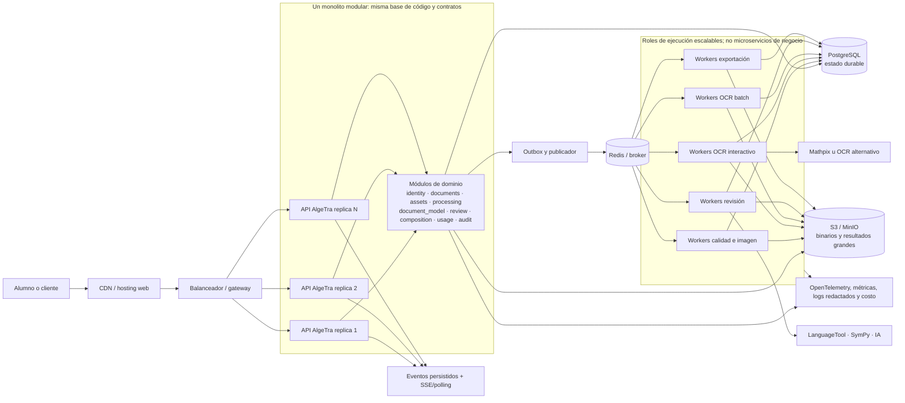

# ADR-001 — Monolito modular escalable con procesamiento asíncrono

> **Tipo:** Architecture Decision Record (ADR)<br>
> **Estado:** aceptado para prototipo, P0 y primera etapa de producción<br>
> **Fecha:** 2026-11-05<br>
> **Decisores:** producto, arquitectura y desarrollo de AlgeTra<br>
> **Relacionados:** ARQ-004, ARQ-005, RNF-MAN-001, RNF-CAP-002 y [arquitectura base](../08-arquitectura-y-tecnologias.md)

## 1. Decisión resumida

AlgeTra se construirá como un **monolito modular escalable**, con:

1. una base de código y un modelo de dominio compartido, organizado por capacidades con límites explícitos;
2. una API FastAPI stateless que puede ejecutarse en varias réplicas detrás de un balanceador;
3. workers asíncronos separados por clase de carga, también escalables horizontalmente;
4. PostgreSQL como fuente durable del estado de negocio;
5. almacenamiento S3 compatible para originales, derivados, respuestas grandes y exportaciones;
6. Redis/Celery como mecanismo inicial de colas y coordinación de ejecución, no como fuente única de verdad;
7. adaptadores versionados para OCR, revisión, IA y otros proveedores;
8. extracción a servicios independientes solo cuando exista evidencia de una frontera estable y un beneficio operativo medido.

La decisión **no** es construir un monolito de un solo proceso, una sola máquina o una única cola. La lógica de negocio comienza modularizada, mientras que el plano de ejecución escala por réplicas, colas y workers.

> **Respuesta directa:** aunque AlgeTra no aspire a pocos usuarios, no se recomienda iniciar con microservicios de negocio. La escala inicial más probable está en API, cargas, OCR, CPU de imagen, exportación, cuotas de proveedores y lecturas; esos ejes se pueden escalar independientemente sin pagar todavía el costo de distribuir cada contexto del dominio.

## 2. Contexto

AlgeTra combina una interacción rápida con procesamiento costoso y externo:

- carga de imágenes y documentos de varias páginas;
- evaluación y transformación de imágenes;
- segmentación, clasificación y OCR por bloque;
- revisión lingüística, matemática y eventualmente IA;
- edición versionada y comparación con el manuscrito;
- composición y exportación a PDF;
- datos privados, posible contenido de menores, cuotas y costos por proveedor.

La arquitectura debe soportar un crecimiento significativo de usuarios sin convertir el primer producto en una red de servicios difíciles de entender. Al mismo tiempo, no es aceptable resolver “monolito” con una aplicación acoplada que solo escala verticalmente.

Los requisitos ya establecen:

- workers horizontales por tipo de carga (`RNF-CAP-002`);
- contrapresión (`RNF-CAP-003`);
- estado durable en PostgreSQL (`RNF-REL-002`);
- idempotencia y aislamiento de fallos (`RNF-REL-003` a `RNF-REL-005`);
- contratos de proveedores sustituibles (`RNF-MAN-002`);
- núcleo modular (`RNF-MAN-001`);
- original, transcripción, edición y sugerencias como capas separadas.

## 3. Impulsores arquitectónicos y tensiones

| Impulsor | Importancia | Consecuencia |
| --- | --- | --- |
| Escalar a muchos usuarios | Muy alta | API stateless, carga directa, límites y capacidad horizontal. |
| Procesamiento costoso | Muy alta | Colas separadas, workers especializados y resultados parciales. |
| Consistencia de documentos y versiones | Muy alta | Transacciones locales en PostgreSQL y modelo canónico único inicialmente. |
| Límites de proveedores externos | Muy alta | Rate limits, circuit breakers, idempotencia y presupuesto. |
| Dominio todavía en descubrimiento | Alta | Evitar fronteras de servicio irreversibles prematuras. |
| Privacidad y auditoría | Muy alta | Autorización de servidor, linaje, minimización y purga. |
| Velocidad de prototipado y aprendizaje | Alta | Despliegue y pruebas con pocos componentes operativos. |
| Independencia futura de equipos | Media | Módulos con APIs internas, contratos, propiedad de datos y eventos. |
| Aislamiento de fallos | Alta | Separar procesos de workers y colas aunque el dominio permanezca unido. |
| Coste operativo | Alta | No multiplicar bases, pipelines, alertas y despliegues sin beneficio comprobado. |

## 4. Opciones consideradas

| Opción | Decisión | Razón principal |
| --- | --- | --- |
| A. Microservicios desde el primer commit | Rechazada por ahora | Las fronteras del dominio aún se validan; introduce red, consistencia eventual, despliegues y observabilidad distribuida antes de necesitarlos. |
| B. Monolito grande sin límites | Rechazada | Es simple al inicio pero impide cambios seguros, pruebas aisladas y extracción futura. |
| C. Monolito modular + workers escalables | **Aceptada** | Conserva transacciones y velocidad de desarrollo, pero escala API y procesamiento por separado. |
| D. Serverless por cada paso | Rechazada como base | OCR, procesamiento de imagen y Chromium pueden ser largos, pesados o sensibles a cold starts; puede usarse para tareas periféricas después. |
| E. Servicios gruesos desde el inicio | Reservada | Puede ser una evolución válida cuando el benchmark revele límites, pero no se justifica antes de conocer las fronteras reales. |

### 4.1. Comparación cualitativa

La siguiente tabla no es una medición de rendimiento; hace explícitos los trade-offs de la decisión.

| Criterio | Microservicios primero | Monolito modular escalable |
| --- | --- | --- |
| Descubrir fronteras de dominio | Desfavorable: un error cruza red y contratos | Favorable: se puede refactorizar dentro del proceso con límites internos |
| Escalar API | Favorable | Favorable con réplicas stateless |
| Escalar OCR/exportación | Favorable | Favorable mediante pools de workers y colas |
| Consistencia de documento | Requiere coordinación distribuida | Transacciones locales y outbox |
| Tiempo hasta primer prototipo | Desfavorable | Favorable |
| Operación inicial | Muchos despliegues, alertas y contratos | Menos unidades, roles separados y observabilidad única |
| Aislamiento de una dependencia | Fuerte si la frontera es correcta | Fuerte a nivel de proceso/cola; menor dentro del API |
| Despliegue independiente por dominio | Favorable | Limitado inicialmente; se puede habilitar después |
| Cambio de límites equivocados | Costoso | Más barato mientras los límites internos sean respetados |
| Escala de equipos | Útil cuando hay varios equipos autónomos | Adecuado mientras exista un equipo o pocos equipos coordinados |

## 5. Arquitectura decidida

### 5.1. Topología lógica



### 5.2. Qué significa “monolito modular” en AlgeTra

**Monolito** describe la unidad inicial de propiedad, código de dominio y evolución; no significa que toda la carga se ejecute en la misma instancia.

**Modular** significa que cada capacidad tiene:

- API pública interna;
- casos de uso propios;
- reglas de dominio sin depender del framework web;
- adaptadores de infraestructura encapsulados;
- propiedad lógica de sus tablas y eventos;
- pruebas que puedan ejecutarse con dobles o fixtures;
- prohibición de importar internals de otro módulo.

**Escalable** significa que se pueden agregar réplicas y recursos en el eje que lo necesita:

- API para solicitudes y conexiones SSE;
- workers OCR para throughput y latencia de proveedor;
- workers de imagen para CPU;
- workers de exportación para Chromium;
- PostgreSQL para operaciones y lecturas, con réplicas/particiones cuando las métricas lo justifiquen;
- S3 para volumen de binarios;
- CDN para recursos públicos.

Un worker de OCR no es un microservicio de “matemáticas” en esta etapa: es un rol de ejecución que usa módulos y contratos del mismo sistema. Podrá convertirse en un servicio si supera los criterios de extracción de la sección 10.

## 6. Límites internos del monolito

| Módulo | Propiedad | Expone | No debe conocer directamente |
| --- | --- | --- | --- |
| `identity` | Principales, sesiones y permisos | Principal autenticado, autorización | Detalles de OCR o editor |
| `workspaces` | Membresías y alcance | Contexto de usuario/workspace | Tablas internas de proveedores |
| `documents` | Documento, página y ciclo de vida | Casos de uso documentales | Implementación de Mathpix |
| `assets` | Originales, variantes, recortes y URLs firmadas | Referencias de activo | Reglas de revisión académica |
| `quality` | Señales y decisión de calidad | Diagnóstico y variantes | UI o proveedor específico |
| `processing` | Trabajos, pasos, outbox y reintentos | Plan y estado de ejecución | Mutaciones arbitrarias de bloques |
| `document_model` | Bloques, geometría, capas y versiones | Modelo canónico y migraciones | JSON interno de Tiptap o proveedor |
| `ocr` | Capacidades, adaptadores y normalizadores | Resultado normalizado | Reglas de cuenta y facturación |
| `review` | Sugerencias, validaciones y decisiones | Propuestas y decisiones | Sustitución silenciosa del contenido |
| `composition` | Proyección, plantillas y paginación | Documento renderizable | Resultado bruto de OCR como fuente final |
| `usage` | Cuotas, costo y límites | Admisión y consumo | Contenido académico en claro |
| `audit` | Eventos protegidos y correlación | Evidencia operativa | Lectura innecesaria del manuscrito |

Reglas obligatorias:

1. Un módulo consume la API pública de otro, nunca su repositorio o tabla interna.
2. Una relación entre módulos se expresa como comando, consulta explícita o evento versionado.
3. Las transacciones síncronas se mantienen dentro del módulo o de un caso de uso que necesite atomicidad; no se simula una transacción distribuida con varias llamadas HTTP internas.
4. Los binarios pasan por `assets`; no se guardan en tablas de dominio ni se transmiten innecesariamente por la API.
5. El modelo canónico no importa tipos de Tiptap, Mathpix Markdown ni respuestas de IA.
6. Toda llamada externa pasa por un adaptador con timeout, clasificación de error, cuota, telemetría y prueba de contrato.

## 7. Estrategia de escalabilidad

### 7.1. Escala por dimensión

| Dimensión de crecimiento | Mecanismo inicial | Señal de saturación | Evolución posible |
| --- | --- | --- | --- |
| Usuarios y solicitudes API | Réplicas stateless, balanceador, caché selectiva y rate limits | p95 de API, CPU, memoria, conexiones y errores | Más réplicas, caché/read model o separar un borde estable |
| Conexiones SSE | Réplicas API, eventos con `event_id`, replay desde estado durable y polling de respaldo | conexiones activas, latencia de evento y pérdida de heartbeat | Broker/fanout dedicado o gateway de eventos |
| Bytes de carga | URLs firmadas, multipart/reanudación y S3 | ancho de banda, errores de subida y latencia de almacenamiento | CDN de carga o regiones de almacenamiento |
| Calidad y preprocesamiento | Cola `image-quality` y workers CPU | profundidad de cola y tiempo de diagnóstico | Pool con CPU dedicada o servicio de imagen |
| OCR interactivo | Cola prioritaria, concurrencia acotada y límite por proveedor | tiempo hasta primer resultado, cuota y errores externos | Gateway OCR o servicio de procesamiento separado |
| OCR batch | Cola independiente y workers elásticos | backlog y edad del trabajo más antiguo | Cluster/pool de batch o workflow durable |
| Revisión | Colas por herramienta y cachés de resultados reconstruibles | latencia por proveedor o CPU | Worker especializado o proveedor alternativo |
| Exportación | Cola `export`, límites de Chromium y workers aislados | tiempo p95, memoria y procesos fallidos | Pool de render dedicado o servicio de exportación |
| Metadatos y estado | Índices, pool de conexiones, partición de tablas de eventos/uso y réplicas de lectura | locks, conexiones, I/O, tamaño y latencia de consultas | Read models, particionamiento avanzado o extracción de un bounded context |
| Binarios | S3 compatible, ciclo de vida y URLs firmadas | costo, throughput y errores de objetos | Almacenamiento regional o políticas por tenant |
| Proveedores externos | Circuit breaker, backoff, idempotencia, límites y proveedores alternativos | cuota, costo, timeout y tasa de error | Adaptador/gateway independiente con contrato estable |

### 7.2. Estado y eventos

El patrón de trabajo será:

1. La API escribe intención, estado y paso en PostgreSQL.
2. La misma transacción inserta un registro en el outbox.
3. Un publicador entrega el mensaje a la cola.
4. El worker reclama el paso con una clave idempotente.
5. El worker escribe resultado, estado y evento de dominio.
6. El evento se publica para notificar; el snapshot durable sigue en PostgreSQL.
7. El cliente recibe SSE cuando es posible y usa `Last-Event-ID`; si pierde eventos, recupera snapshot y eventos posteriores.

Redis puede ofrecer transporte rápido o fanout, pero no puede ser la única prueba de que un trabajo existe, terminó o debe auditarse.

### 7.3. Escalado de PostgreSQL

La decisión inicial es un PostgreSQL durable, no una base por feature. El crecimiento se tratará en este orden:

1. índices y consultas verificadas;
2. límites de conexión y pool;
3. separar lecturas reconstruibles o de baja frescura;
4. réplicas de lectura cuando la carga sea predominantemente de lectura;
5. particionar tablas append-only como eventos, uso o auditoría si el tamaño y las consultas lo justifican;
6. separar un modelo de lectura o un bounded context solo con evidencia;
7. evaluar sharding o multi-región únicamente después de demostrar que los pasos anteriores no alcanzan.

La consistencia de mutaciones documentales permanecerá en el primario. Una réplica de lectura puede tener retraso y nunca se usará para confirmar inmediatamente una edición como persistida.

### 7.4. Autoescalado

El sistema debe escalar por señales del trabajo, no solo por CPU:

- profundidad y edad de cada cola;
- tiempo hasta primer resultado útil;
- concurrencia por proveedor;
- duración y tasa de error por paso;
- CPU/memoria de imagen y Chromium;
- conexiones y latencia de PostgreSQL;
- conexiones activas y retraso de eventos SSE;
- costo acumulado y presupuesto.

La plataforma de contenedores sigue abierta. Si se elige Kubernetes, HPA o un mecanismo equivalente puede ajustar réplicas; si se elige otra plataforma gestionada, debe conservarse la misma separación de roles y métricas.

## 8. Resiliencia y aislamiento

| Riesgo | Protección en la arquitectura |
| --- | --- |
| Caída de una réplica API | Balanceador, réplicas stateless y recuperación por estado durable. |
| Desconexión del navegador | El trabajo confirmado vive en PostgreSQL y se recupera por consulta/SSE. |
| Falla de una página | Pasos por página/bloque, estado parcial y reintento acotado. |
| Timeout OCR | Timeout, backoff, circuit breaker, límite de concurrencia y error normalizado. |
| Duplicación de mensaje | Idempotency key por activo, paso, procesador, versión y opciones. |
| Saturación de batch | Colas separadas, prioridad de interactivo y contrapresión. |
| Falla de exportación | Worker aislado, límite de memoria/tiempo y documento fuente intacto. |
| Redis no disponible | No se pierde el estado de negocio; outbox puede reintentarse y el servicio degrada admisión. |
| Réplica de lectura retrasada | Las confirmaciones usan primario; las lecturas tolerantes indican posible retraso. |
| Error de proveedor | Adaptador, respuesta original, procedencia y fallback visual. |
| Error de módulo interno | Límites, pruebas, flags y despliegue de workers fuera del proceso API cuando sea necesario. |

## 9. Por qué no microservicios desde ahora

La decisión no afirma que los microservicios sean malos ni que AlgeTra nunca los necesitará. Afirma que todavía no se ha demostrado el problema que justificaría su costo.

### 9.1. Fronteras aún inestables

Captura, documentos, assets, calidad, OCR, revisión y composición comparten el ciclo de vida de una página y la procedencia de sus versiones. Separarlos ahora obligaría a definir APIs, contratos de datos y consistencia distribuida antes de observar qué cambios realmente ocurren juntos.

### 9.2. El cuello de botella esperado no es uniforme

La API, el OCR, el procesamiento de imagen, el proveedor externo y Chromium tienen perfiles diferentes. Esos perfiles ya se pueden aislar como deployments/roles de ejecución y colas sin convertir cada capacidad de negocio en un servicio con base de datos propia.

### 9.3. El dominio exige trazabilidad y decisiones atómicas

Una edición, su versión, la ambigüedad y su procedencia tienen relaciones que conviene guardar de forma consistente. Microservicios implicarían eventos, sagas, compensaciones, replicación de datos y consultas eventualmente consistentes para un problema que aún puede resolverse localmente.

### 9.4. “Muchos usuarios” no equivale a “muchos servicios”

El número de usuarios influye en capacidad, disponibilidad y aislamiento, pero la respuesta puede ser:

- múltiples réplicas stateless;
- carga directa a objetos;
- colas con backpressure;
- workers horizontales especializados;
- bases gestionadas y réplicas de lectura;
- cachés y CDN;
- límites por usuario y proveedor;
- observabilidad y pruebas de carga.

Microservicios aportan independencia de despliegue, datos y equipos; no son un requisito automático de horizontalidad.

## 10. Criterios para extraer un módulo como servicio

La extracción se aprobará mediante un ADR nuevo y deberá cumplir **todos** los criterios de preparación y al menos una razón fuerte de separación.

### 10.1. Preparación obligatoria

- frontera de negocio estable y expresable como bounded context;
- API o eventos versionados y documentados;
- propiedad clara de datos y plan de migración;
- ausencia de lecturas directas a tablas de otro módulo;
- idempotencia, timeouts, reintentos y manejo de duplicados;
- trazas y métricas de extremo a extremo;
- pruebas de contrato y estrategia de compatibilidad;
- plan de despliegue, rollback y operación independiente.

### 10.2. Razones suficientes de separación

Separar solo si se demuestra una o más de estas condiciones:

1. el módulo requiere escalar con un perfil que no puede resolver su worker o pool actual;
2. necesita GPU, sistema operativo, dependencia o runtime incompatible;
3. existe una frontera de seguridad, residencia o cumplimiento que exige aislamiento;
4. la disponibilidad del módulo debe aislarse más allá de una cola/proceso;
5. un equipo autónomo necesita ciclo de despliegue independiente y el costo de coordinación está medido;
6. el módulo produce un beneficio claro de costo o latencia al operar por separado;
7. una dependencia externa exige un gateway aislado para proteger límites y presupuesto.

### 10.3. Primeros candidatos, no decisiones

Si la evidencia lo justifica, los candidatos de menor riesgo serían:

- **exportación/render:** dependencia pesada de Chromium y perfil de memoria distinto;
- **gateway de proveedores OCR:** cuotas, circuit breakers, múltiples proveedores y egress controlado;
- **procesamiento batch:** backlog y prioridad muy diferentes al flujo interactivo;
- **procesador especializado con GPU:** runtime y ciclo de escala incompatible.

No se recomienda extraer inicialmente `documents` o `document_model`, porque son el núcleo de consistencia y procedencia.

## 11. Plan de evolución

```text
Etapa 0 — prototipo
  Monolito modular local + API + workers + PostgreSQL/Redis/MinIO
  Validar FBS, feature model, OCR, latencia, costo y modelo canónico

Etapa 1 — producto regional
  Web en CDN
  API stateless con réplicas
  Workers por cola y prioridad
  PostgreSQL/S3/Redis gestionados
  Outbox, SSE reanudable, observabilidad y límites

Etapa 2 — crecimiento medido
  Autoescalado por cola, edad, latencia y costo
  Réplicas de lectura, particiones y pools de conexión
  Aislamiento de exportación, batch o proveedor si las métricas lo exigen

Etapa 3 — extracción selectiva
  ADR de cada servicio
  Contrato y anti-corruption layer
  Migración de datos y eventos
  Despliegue canario, rollback y ownership independiente
```

La extracción no debe ser un objetivo de prestigio. El objetivo es que cada separación reduzca una limitación real sin convertir el sistema en un distributed monolith.

## 12. Consecuencias

### Positivas

- Menor complejidad operativa inicial sin renunciar a escala horizontal.
- Refactorización rápida mientras se descubre el dominio.
- Transacciones y procedencia más simples de mantener.
- Escalado independiente de API, OCR, imagen y exportación.
- Menor latencia y menos fallos de red en llamadas entre capacidades internas.
- Un modelo canónico único evita traducciones prematuras entre servicios.
- La futura extracción queda preparada por contratos, eventos y propiedad de datos.

### Negativas

- La mayoría de los módulos no tendrá despliegue independiente al comienzo.
- Una falla dentro del proceso API puede afectar a varios módulos si no se aísla mediante workers o límites de recursos.
- Un cambio grande del monolito requiere coordinación y pruebas de regresión completas.
- PostgreSQL compartido exige disciplina de ownership y migraciones compatibles.
- Si el equipo ignora las reglas internas, el monolito puede degradarse a una bola de lodo.
- Una extracción posterior tendrá costo de migración; no se promete que sea gratuita.

### Riesgos aceptados y mitigaciones

| Riesgo aceptado | Mitigación obligatoria |
| --- | --- |
| API y módulos comparten proceso | Límites de módulos, timeouts, límites de recursos y workers fuera del API para tareas pesadas. |
| Base de datos común | Propiedad de tablas, revisiones de esquema y prohibición de acceso cruzado. |
| Despliegue conjunto | Flags, migraciones backward-compatible, canary y pruebas de contrato internas. |
| Escala desigual | Colas y deployments de workers separados; API stateless. |
| Extracción tardía | Diseñar desde ahora interfaces, eventos, IDs y linaje sin introducir red prematuramente. |

## 13. Plan de validación arquitectónica

Antes de declarar que la arquitectura escala, se ejecutarán pruebas con una carga de referencia:

1. **API:** solicitudes concurrentes, autenticación, listados, mutaciones y conexiones SSE.
2. **Carga:** archivos grandes, varias páginas, interrupciones y reanudación.
3. **Colas:** mezcla de interactivo y batch, prioridad, contrapresión y envejecimiento del backlog.
4. **Workers:** escalado de calidad, OCR y exportación de manera independiente.
5. **Proveedor:** latencia, timeout, cuota, duplicación de callback y circuit breaker.
6. **PostgreSQL:** conexiones, locks, índices, crecimiento de eventos y lecturas retrasadas.
7. **Objetos:** throughput, URLs firmadas, lifecycle y purga.
8. **Resiliencia:** reinicio de API/worker/Redis, pérdida de SSE y reproceso idempotente.
9. **Costo:** costo por página, variante, proveedor, exportación y documento terminado.
10. **Seguridad:** aislamiento entre usuarios, expiración de URLs y ausencia de contenido sensible en logs.

Los umbrales se toman de la ERS y se ajustan con evidencia del benchmark; no se declarará capacidad de usuarios solo a partir del número de réplicas.

## 14. Evidencia de investigación

La decisión se contrastó con documentación técnica y literatura de arquitectura. Estas fuentes no sustituyen las pruebas de AlgeTra; ayudan a explicitar los trade-offs.

| Fuente | Hallazgo relevante | Aplicación a AlgeTra |
| --- | --- | --- |
| [Martin Fowler — Monolith First](https://www.martinfowler.com/bliki/MonolithFirst.html) | Las fronteras de servicio son difíciles de acertar al inicio; conviene preservar la capacidad de aprender y refactorizar. | Monolito modular primero, con contratos y límites internos para no bloquear una extracción posterior. |
| [Microsoft Azure Architecture Center — Microservices](https://learn.microsoft.com/en-us/azure/architecture/guide/architecture-styles/microservices) | Microservicios permiten escala y despliegue independiente, pero añaden complejidad, consistencia distribuida, versionado, observabilidad y latencia de red. | Escalar por API/colas/workers primero; distribuir solo si el beneficio compensa la complejidad. |
| [Microsoft — Assessment of microservices](https://learn.microsoft.com/en-us/azure/architecture/guide/technology-choices/microservices-assessment) | La extracción requiere comprender dependencias, datos, volumen y fronteras; recomienda avanzar gradualmente y con patrones de strangler/anti-corruption. | Definir criterios de extracción y migración antes de convertir un módulo en servicio. |
| [AWS Prescriptive Guidance — Decomposing monoliths](https://docs.aws.amazon.com/prescriptive-guidance/latest/modernization-decomposing-monoliths/introduction.html) | Un monolito puede ser válido cuando las responsabilidades aún no están claras; la descomposición debe considerar negocio, transacciones y dependencias. | Mantener consistencia documental local y reservar descomposición por capacidad para una etapa basada en evidencia. |
| [Celery — Routing Tasks](https://docs.celeryq.dev/en/stable/userguide/routing.html) | Las tareas pueden dirigirse a colas y workers específicos, permitiendo separar cargas y ajustar consumo. | Usar colas `image-quality`, `ocr-interactive`, `ocr-batch` y `export` sin crear un servicio de negocio por cola. |
| [Kubernetes — Horizontal Pod Autoscaling](https://kubernetes.io/docs/concepts/workloads/autoscaling/horizontal-pod-autoscale/) | El escalado horizontal agrega réplicas de un workload según métricas; el mecanismo es independiente del modelo de dominio. | Mantener la plataforma abierta y escalar roles stateless/workers con HPA o equivalente. |
| [PostgreSQL — High Availability, Load Balancing and Replication](https://www.postgresql.org/docs/current/high-availability.html) | Las réplicas de lectura y failover tienen trade-offs de sincronización y consistencia. | Mantener escrituras documentales en primario y usar réplicas solo con una política explícita de frescura. |

## 15. Decisión futura

Este ADR deberá revisarse si:

- el benchmark de carga demuestra que un pool no puede cumplir el SLO aun después de escalarlo;
- se selecciona una plataforma o requisito multi-región que cambie la topología;
- aparece un módulo con dependencia/GPU/residencia incompatible;
- se forman equipos autónomos que requieren despliegue independiente;
- el modelo de datos y los contratos de un bounded context quedan estables;
- la operación del monolito genera un incidente o costo que un servicio aislado resolvería claramente.

La revisión debe crear un ADR nuevo o marcar este como superseded; no se debe editar la historia de la decisión sin dejar registro.
